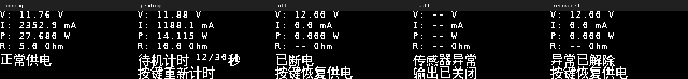

# 传感与检测技术课程大作业：直流能耗监测与自动断电

**题目：基于 MSPM0G3507 和 INA219 的低压直流设备能耗监测与待机自动断电系统设计与制作。**

使用 MSPM0G3507 核心板与底板、INA219、128×64 I²C OLED 和高电平导通的 MOSFET 模块，基于 Zephyr 树外开发。面向 **12V 直流负载**，显示电压、电流、功率、累计电量和等效阻值，并实现待机断电、2W功率上限保护及采集异常断电。仅使用底板 PA30 按键，提醒全部显示在 OLED 上。

## 三种期望运行状态

下表按标称 **12V、纯电阻负载**计算，使用 `P=U²/R=144/R`。固件判断以 INA219 的**实测功率**为准；实际供电电压变化时，阻值分界随之变化。

| 状态 | 实测功率阈值 | 12V时对应负载阻值 | 预期行为 |
|---|---|---|---|
| 正常运行 | **0.30W ≤ P < 2.00W** | **72Ω < R ≤ 480Ω** | 保持供电，OLED显示U/I/P/E/R和“供电中” |
| 低功率待机 | **P < 0.30W** | **R > 480Ω**；空载也属于低功率 | 连续计时30秒 → OLED提醒5秒 → MOSFET断电，显示“已断电／按键恢复供电” |
| 高功率保护 | **P ≥ 2.00W** | **R ≤ 72Ω** | 检出后立即关闭输出并锁存，OLED显示“功率超限 已断电／按键恢复供电” |

边界：480Ω对应0.30W，保持正常运行；72Ω对应2.00W，触发功率保护。负载接通后有 **3秒启动宽限**，仅延后低功率计时；2W保护在启动宽限期间同样生效。持续低功率从按键恢复起约 **3+30+5=38秒** 后断电，已经运行的负载降到低功率后约 **30+5=35秒** 后断电。

| 演示负载 | 12V理论电流 | 理论功率 | 用途 |
|---|---|---|---|
| 220Ω | 54.5mA | 0.655W | 正常运行 |
| 680Ω | 17.6mA | 0.212W | 验证30秒待机计时与5秒提醒 |
| 68Ω | 176.5mA | 2.118W | 验证2W保护断电 |

演示建议使用额定 **5W及以上的功率电阻**，电源限流约 **0.2A**。可变电阻需要满足相应位置的允许电流和耗散功率；普通小电位器不适合直接承担该功率负载。本功能由周期采样后执行关断，不能代替硬件短路保护。

只演示正常供电与低功率待机两档时，可选 **330Ω／1W**（12V下36.4mA、0.436W）和 **1kΩ／0.25W**（12mA、0.144W）。正常档功率至少0.30W，已超过普通1/4W电阻的额定功率；1/4W可用于上述1kΩ待机档。统一采购1W规格也可。前表5W电阻方案为三档演示保留了更大的耗散余量。

### 电位器作为负载时的功率限制

电位器的额定功率对应整段阻体，滑片取小阻值时需要按使用比例降额。以1kΩ／5W为例，按 `I≈√(5/1000)` 估算允许电流约70.7mA；12V下单独作负载时，阻值理论上需至少约170Ω，并留出温度和滑片电流余量。因此这类电位器适合正常／待机演示；2W超限测试使用68Ω／5W固定电阻。计算方法参考 [Bourns 电位器手册](https://www.bourns.com/data/global/pdfs/OnlinePotentiometerHandbook.pdf)，具体限值以所用型号手册为准。

电位器调到接近0Ω会形成近短路。调整阻值、改变接线和测量电阻均在断电后进行；电阻档测量需将被测电阻从带电回路隔离。发现开路、阻值跳变或异味时，停止使用该负载。

## 按键、恢复与异常保护

上电或复位后 **PB14=低，负载关闭**。INA219采集正常后，按下并松开 **底板 S2／PA30** 恢复供电；一次完整按下、松开产生一次动作，建议按住约0.2秒后松开。核心板S2／PA17未启用。

- 提醒期间功率回到0.30W及以上，取消待机倒计时；按PA30也可取消提醒并重新进入启动宽限。
- 自动断电后按PA30恢复供电，累计电量保留。MCU复位会清零累计电量。
- 高功率断电后保持锁存，按PA30可尝试恢复；负载仍达到2W时，会在下一次有效测量后再次断电。断电后的实时功率可回落到0，OLED保留“功率超限”原因。
- 采集异常同样立即关闭负载：INA219通信失败、转换轮询超过50ms、母线电压超过26V、分流压降达到±320mV，或供电期间有效采样间隔超过500ms。采集恢复后显示“异常已解除／按键恢复供电”，等待PA30恢复。

R100（0.1Ω）分流电阻的±320mV量程边界对应约±3.2A。12V时换算约38.4W、3.75Ω；**本项目先由2W功率上限保护限制负载**。3.75Ω属于量程边界，演示使用上表的68Ω负载即可。通信与超时异常在任意阻值下都可能触发。

## 接线

详细逐线连接、电源位置和负载回路见 [MSPM0G3507接线表](docs/MSPM0G3507接线表.md)。GPIO名称统一使用PA/PB形式。

| 功能 | GPIO | 底板位置 |
|---|---|---|
| OLED SCL / SDA | **PA1 / PA0** | ToF接口P13第3 / 第4脚 |
| INA219 SCL / SDA | **PB2 / PB3** | 无线串口接口P15第4 / **第8脚**，第6脚为GND |
| MOSFET控制 | **PB14** | P13第5脚，高电平导通，低电平断电 |
| 恢复／取消提醒 | **PA30** | 底板S2，按下为低 |
| UART TX / RX | PB15 / PB16 | P7第4 / 第3脚，115200、8N1、3.3V电平 |
| SWDIO / SWCLK | PA19 / PA20 | 核心板SWD接口 |

OLED和INA219分用两组独立总线，通过Zephyr `gpio-i2c` 开漏驱动，配置100kHz。当前Zephyr版本尚无对应的MSPM0硬件I²C驱动；本仓库包含GPIO输入读回适配。OLED自动尝试0x3C、0x3D；INA219默认0x40，分流电阻R100。

由同一12V电源分支供给底板XT入口和负载，控制逻辑位于负载开关之前。OLED／INA219的 **VCC接3.3V**，各模块共地。MOSFET控制端兼容3.3V，并需要硬件下拉保证复位期间关闭。PA14固定低电平关闭底板蜂鸣器，因此核心板LED2可常亮；该灯不表示负载状态。

本次使用的J-Link“3.3V”线具备供电能力，**外部电源开启时断开这根线，只保留GND、PA19、PA20**。本机调试器已设置固定VTref=3.3V并验证三线调试可用。标准调试器的真正VTref检测输入按其手册连接；核心板SWD电源脚的资料／实物差异见接线表。

## OLED与测量

常态页显示U、I、P、E、R及状态，低功率时显示“待机计时 n/30s”；提醒页显示“即将断电”、剩余秒数和“按键取消断电”。OLED后台每2秒尝试恢复失联显示。显示工作在独立线程，INA219使用另一条总线。



INA219采用连续转换配置0x3E67，电压与分流ADC各16次平均，读取原始寄存器后进行整数换算；每次采集完成再等待100ms。功率为实测电压×电流，电量按实际采样时间进行梯形积分，仅累计正向功率。

阻值 `R=U/I` 用于电阻性负载。负载断电、采样无效、电流低于1mA或反向时显示 `--`；风扇等负载的U/I不代表其线圈电阻。低边开关下INA219母线电压以系统GND为参考，关断后可仍显示12V。

## 构建、烧录和测试

本机使用conda `zephyr`环境、Zephyr 4.4.99（提交 `6ab04eeedd2036cdae06538056bc55848f9e5f82`）、Zephyr SDK 1.0.1。板级定义、设备树与应用均在本仓库内，外部Zephyr源码无需修改。默认目标 `energy_mspm0g3507`，80MHz、Flash128KB、RAM32KB。

已有Zephyr工作区时：

```bash
./scripts/test.sh
./scripts/build.sh
```

构建脚本默认使用 `~/anaconda3/envs/zephyr/bin/python`、`~/zephyrws/zephyr`、`~/zephyr_sdk`，可通过 `ZEPHYR_PYTHON`、`ZEPHYR_BASE`、`ZEPHYR_SDK_INSTALL_DIR` 覆盖。普通版本输出 `build-mspm0/zephyr/zephyr.{elf,hex,bin}`，日志走UART2。

```bash
conda activate zephyr
export ZEPHYR_BASE="$HOME/zephyrws/zephyr"
export ZEPHYR_SDK_INSTALL_DIR="$HOME/zephyr_sdk"
west flash -d build-mspm0 --runner jlink

# J-Link RTT调试版本
ENERGY_BUILD_DIR="$PWD/build-mspm0-debug" ./scripts/build.sh -- -DEXTRA_CONF_FILE=debug.conf
west flash -d build-mspm0-debug --runner jlink
```

全新环境可在安装Zephyr SDK、Python及west后，通过本仓库 `west.yml` 获取固定版本依赖：

```bash
west init -m https://github.com/Loneyzs/sensor-detection-energy-monitor --mr main energy-workspace
cd energy-workspace
west update
west zephyr-export
pip install -r zephyr/scripts/requirements.txt
cd energy-monitor
west build -b energy_mspm0g3507 -d build-mspm0 .
```

参数集中在 [src/app_config.h](src/app_config.h)：低功率300mW、功率上限2000mW、待机30秒、提醒5秒、启动宽限3秒，修改后重新构建烧录。

主机测试启用AddressSanitizer和UndefinedBehaviorSanitizer，覆盖积分、阈值边界、超功率锁存和恢复、完整业务流程、按键消抖、OLED总线传输与INA219原始值换算。测试同时生成PBM页面，`python tools/preview_oled.py` 可更新PNG总览，需要Pillow。

## 目录与验证

- `src/`：监测状态机、采集、按键、OLED驱动与显示。
- `boards/`、`dts/`：MSPM0G3507板级定义、两路I²C与GPIO绑定。
- `tests/`：四组主机测试及OLED页面预览。
- `docs/`：核心板／底板原理图、传感器／OLED资料、接线表和验证记录。
- `tools/`：字体子集与OLED预览生成脚本；字体许可保留在docs中。

[验证记录](docs/验证记录.md)区分实物验收与主机模拟测试。构建目录和本地调试备份不纳入Git仓库。硬件资料与字体保留原作者的权利及许可说明。
