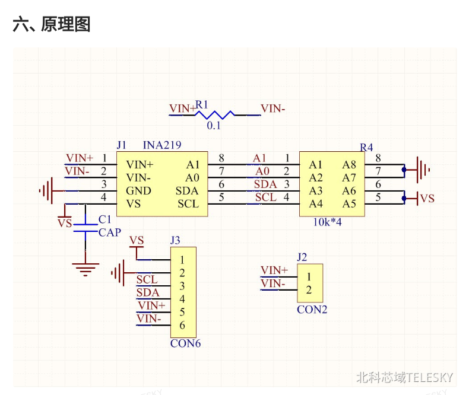

# MSPM0G3507 核心板 + 底板接线与迁移

当前主控为 MSPM0G3507，核心板插在 MotherBoard 上。OLED 与 INA219 分用两组 I²C，不需要并接 SDA/SCL。全文以 PA/PB 名称标识 GPIO，排针脚号用于实物定位。

依据仓库 `MSPM0G3507_CoreBoard V1.0 原理图.pdf` 第2页（图内版本 V1.0.1.0）、`MSPM0G3507_MotherBoard V1.0 原理图.pdf` 第4、5页（图内版本 V1.0.3.0）。GPIO 已与 TI 芯片资料及当前 Zephyr 引脚定义交叉核对。

## 逐线连接

以下电源位置分别供两个模块使用，可直接在底板取电。按排针的1脚标记确认方向，勿凭插头朝向判断脚序。

| 模块端子 | GPIO / 电源 | 底板位置 | 说明 |
|---|---|---|---|
| OLED SCL | PA1 | ToF 接口 P13 第3脚 | OLED 独立总线时钟 |
| OLED SDA | PA0 | ToF 接口 P13 第4脚 | OLED 独立总线数据 |
| OLED VCC | 3.3V | 姿态传感器接口 P18 第1脚 | P13 第1脚为5V，本项目不接该脚 |
| OLED GND | GND | ToF 接口 P13 第2脚 | 公共地 |
| INA219 SCL（J3-3） | PB2 | 无线串口接口 P15 第4脚 | INA219 独立总线时钟 |
| INA219 SDA（J3-4） | PB3 | 无线串口接口 P15 第8脚 | **第6脚为GND，SDA接第8脚** |
| INA219 VS／VCC（J3-1） | 3.3V | 编码器接口 P19 第2脚 | P19/P20/P21/P22 第2脚均接3.3V；P15 第7脚为5V，不接 |
| INA219 GND（J3-2） | GND | 无线串口接口 P15 第5或第6脚 | 与电源负极共地 |
| MOSFET IN / SIG / EN | PB14 | ToF 接口 P13 第5脚 | 高电平导通，低电平断电，控制端兼容3.3V |
| MOSFET 控制参考地 | GND | 底板任一 GND，例如 P18 第2脚 | 模块自带下拉可沿用，否则控制端加约10kΩ下拉 |
| 12V 电源负极 | GND | 系统公共地 | 与 MCU、INA219、OLED、开关控制地共地 |
| 恢复 / 重新计时 | PA30 | **底板 S2** | 板上已有连接，按下为低，无需外接按键 |

底板 S2（PA30）与核心板 S2（PA17）功能不同。本项目使用底板 S2。P13 不再插 ToF 模块，P15 不再插无线串口模块。其他编码器/IMU模块也不要插入上述已占用的电源排针位置。

PA0/PA1 在核心板上已有10kΩ上拉至3.3V。PB2/PB3 使用 INA219 模块的3.3V上拉；模块没有上拉时，各补约4.7kΩ至3.3V。两组总线均采用开漏输出，信号线分别连接，地线共地。

## 新INA219模块与固定负载

图中分流R1为0.1Ω；J3第1～6脚依次为VS、GND、SCL、SDA、VIN+、VIN−。J2第1脚为VIN+、第2脚为VIN−，与J3对应引脚同网。负载电流通过VIN+／VIN−功率端子，VS/GND仅给芯片供电；VS接3.3V，图中SCL/SDA的10kΩ上拉随之为3.3V，A0/A1默认下拉对应0x40。

| 负载 | 电流 | INA219母线电压 | 负载功耗 | 分流压降／耗散 | 行为 |
|---|---:|---:|---:|---:|---|
| **5Ω／50W** | **约2.353A** | **约11.765V** | **约27.682W** | **235.3mV／0.554W** | 正常供电 |
| **10Ω／50W** | **约1.188A** | **约11.881V** | **约14.116W** | **118.8mV／0.141W** | 连续低功率30秒后断电 |

以上按12V输入、串联0.1Ω分流且忽略开关／接线损耗计算。INA219读VIN−对地母线电压，带载时比12V输入低一个分流压降。软件阈值为 **21W**，使用实测电压×电流判断；量程继续为±320mV（约±3.2A）。3Ω负载约产生387mV分流压降，超出当前量程。

分流电阻为2512封装，用户估计额定1W或2W，本方案按至少1W使用，5Ω档约耗散0.55W；其额定功率未在原理图标出，带载温升留待实物调试。用户确认电源、MOSFET及连接线满足约2.35A带载。两只50W负载使用鳄鱼夹连接并按规格散热，更换负载时断电。

## 12V 负载与板上供电

正常使用由同一12V电源分支供给底板 XT 电源入口和负载回路，MCU、OLED、INA219 逻辑电源始终位于负载开关前。用户实物入口为 XT30；仓库底板图将 P1 标为 XT60_Header，接线以实物正负极标识为准。

底板供电路径为 XT 输入 → 开关/保护 → VCCBAT → SCT2450 降压5V → 3.3V稳压；核心板也有5V→3.3V稳压电路。使用板上电源系统，不再接入旧的故障稳压模块。INA219/OLED VCC统一接3.3V，12V只进入底板电源入口和负载功率回路。

| MOSFET 类型 | 正极路径 | 回流路径 |
|---|---|---|
| 高边模块 | 12V+ → 开关输入 → 开关输出 → INA219 VIN+ → VIN− → 负载+ | 负载− → 12V− |
| 低边模块 | 12V+ → INA219 VIN+ → VIN− → 负载+ | 负载− → 开关负载端 → 开关地端 → 12V− |

开关具体端子与额外供电按现有模块丝印、型号核对。低边开关的负载负极只经开关回流，避免其他地线旁路开关。INA219 VIN− 是分流后的负载正端；低边方案关闭后，测得的对地母线电压可仍为12V。系统共地、无电气隔离。本方案计入0.1Ω分流，负载功耗为 `144R/(R+0.1)²` W。

## J-Link 与日志

| 信号 | GPIO / 电源 | 位置 |
|---|---|---|
| J-Link SWDIO | PA19 | 核心板 SWD P1 第9脚 |
| J-Link SWCLK | PA20 | 核心板 SWD P1 第7脚 |
| J-Link GND | GND | 核心板 SWD P1 第6或第8脚 |
| J-Link nRESET（可选） | RST | 核心板 SWD P1 第1脚 |
| 标准 J-Link VTref | 板上3.3V | 例如底板 P20 第2脚，或核心板 P2 第5/6脚 |
| 日志 UART TX | PB15 | 底板串口 P7 第4脚，接 USB-TTL RX |
| 日志 UART RX | PB16 | 底板串口 P7 第3脚，接 USB-TTL TX |
| USB-TTL GND | GND | 底板串口 P7 第2脚 |

串口115200、8N1、3.3V电平；P7 第1脚为5V，使用USB-TTL时保持不接。RTT调试版本关闭UART控制台，通过J-Link读取日志。

**SWD 电源脚存在资料与实物差异：仓库核心板图的 P1 第10脚明确连接 VCC5V；用户实物 SWD 接口标为3.3V。不得按此图把第10脚认定为通用3.3V参考脚，应核对实物版本与实际电压。**

标准 J-Link 的 VTref 为电压检测输入，板子由XT入口供电时，可将真正的 VTref 接板上3.3V；J-Link额外的3.3V/5V供电输出保持断开。参见 [SEGGER 接口定义](https://kb.segger.com/20-pin_J-Link_Connector)。当前这套接线的3.3V线能够供电，实际使用时拔掉此线，由底板XT入口供电，仅保留GND、PA19/SWDIO、PA20/SWCLK，已验证可调试。本机J-Link已设固定VTref=3.3V，该报告值属于配置值；板上电压需实测。换调试器时按其实际VTref接口要求重新核对。

## 软件实现与行为

当前 Zephyr 树具备 MSPM0 的时钟、GPIO、UART、Pinctrl 支持，尚无对应的硬件I²C驱动。迁移使用两路独立 `gpio-i2c`，PA1/PA0 对应芯片 I²C0 引出位置，PB2/PB3 对应 I²C1 引出位置；当前固件通过GPIO模拟I²C，两组均请求100kHz，实际速率受软件执行与调度影响。

应用内补齐该版本 MSPM0 GPIO 输出模式的输入读回设置，确保开漏 SDA/SCL 可读取应答及总线电平；外部 Zephyr 源码保持完整。SCL时钟延展等待上限配置100µs，INA219转换轮询50ms，采样间隔异常仍触发故障关断。实物已验证两组设备通信与OLED显示。

系统时钟80MHz，使用内部SYSOSC和PLL，未依赖板上40MHz晶振。Flash128KB、RAM32KB。上电PB14保持低，正常采集后按下并松开底板S2恢复供电；固定5Ω为正常档、10Ω为待机档，低功率阈值21W，连续30秒后直接断电。OLED仅显示V、I、P、R和中文状态；按键恢复供电或重新计时。参数位于 `src/app_config.h`。

PA14 同时连接核心板低有效 LED2 与底板高有效蜂鸣器，固件固定输出低以关闭蜂鸣器，核心板 LED2 可因此常亮。运行、待机、断电和故障均由OLED显示，LED2不表示负载供电状态。其他板载按键未启用。

默认构建目标 `energy_mspm0g3507`，输出 `build-mspm0/zephyr/zephyr.{elf,hex,bin}`。
